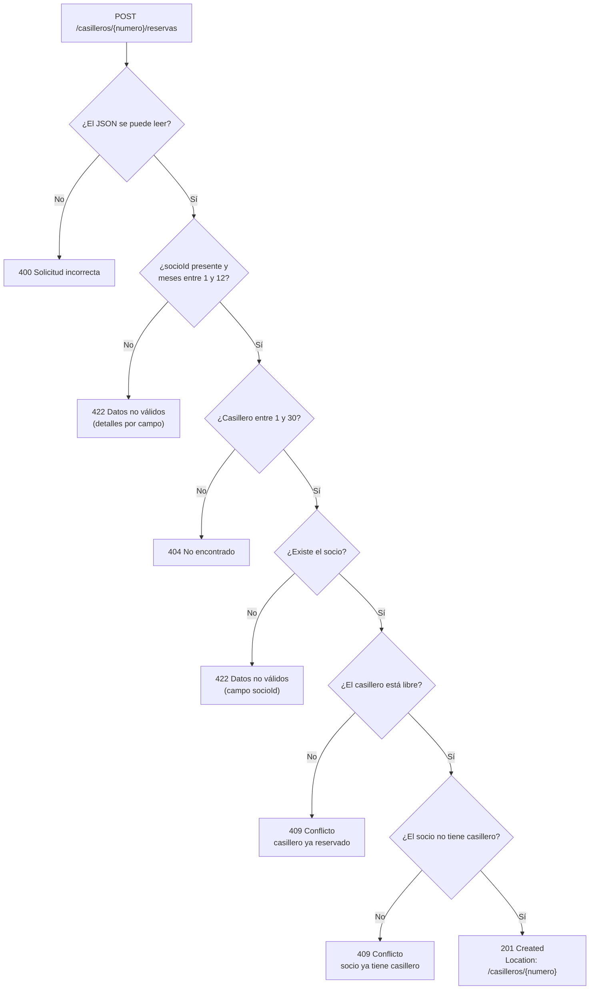

# gimnasio-api

API REST para reservar los casilleros del gimnasio «Fuerza Viva». Ejercicio práctico 1.4: códigos de estado HTTP y validación de datos.

## Cómo ejecutar

```
./gradlew bootRun
./gradlew test
```

La API queda en `http://localhost:8080`.

## Endpoint

`POST /casilleros/{numero}/reservas`

```json
{"socioId": 1, "meses": 3}
```

## Diagrama de decisión



## Autores

- Anthony (anthonyrs25)
- Jairo Arevalo (jiarevalo-hub)